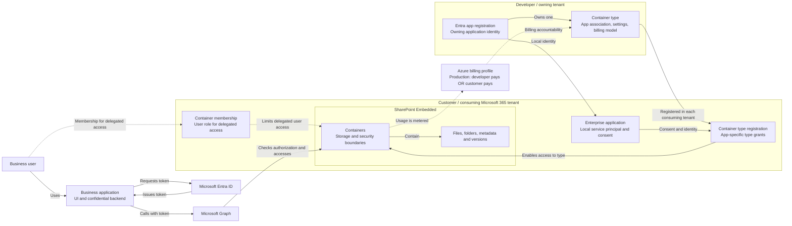

# SharePoint Embedded: customer architecture

SharePoint Embedded lets a business application provide its own document
experience while storing the content in the customer's Microsoft 365 tenant.
Microsoft Graph is the API; Microsoft Entra ID supplies identities and tokens.

The diagram shows a typical production deployment. The developer and customer
can be the same organization; in that case, the two tenant boxes represent
different responsibilities within one tenant.

Solid arrows describe the main relationship or request; dotted arrows describe
conditional access or billing relationships. The [accompanying picture](sharepoint-embedded-architecture.png)
is illustrative: Microsoft Graph itself is the API, not an additional required
gateway. Billing covers storage and other usage, not just API calls.

## What each element does

| Element | Why it is needed |
| --- | --- |
| Business user and business app | The app supplies the customer experience and business workflow; SharePoint Embedded is an API-based platform, not the app's user interface. User sign-in and container membership apply to delegated user scenarios, not unattended app-only operations. |
| Confidential backend | Container creation must use a confidential client, even when acting for a user. A browser or mobile public client therefore needs a protected backend for creation. |
| Developer / owning tenant | Holds the app registration and the container type. It may be the customer's tenant or a separate software vendor's tenant. |
| Entra app registration and local service principal | The registration defines the application identity; the service principal represents that app in each consuming tenant. Entra authenticates the app and, where applicable, the user, and issues Graph tokens. |
| Graph permissions and consent | Permit the app to request the relevant operations. Registration requires customer admin consent; app-only Graph permissions also require admin consent. Consent by itself does not grant access to container content. |
| Container type | The owning app's storage family: it associates the app with its containers and defines access, selected behaviors and billing accountability. One owning app is associated with one container type. |
| Type registration and app grants | Registration in **each** consuming tenant enables that type there and specifies what each app can do, such as create containers or read/write content. This is required even if the developer and consuming tenants are the same. |
| Customer Microsoft 365 tenant | Hosts the containers and their content within its Microsoft 365 tenant boundary. It needs SharePoint available and an administrator for the applicable onboarding and consent steps. |
| Container and files | A container is the storage, security and compliance boundary for a collection of files and folders. A business app might use one container per project or case. |
| Container membership | For delegated access, each user needs a container role, such as Reader or Writer. The effective access is limited by both the app's type grant and the user's role. App-only access is not limited by a user's membership. |
| Microsoft Graph | The application's API for creating containers and working with content. Graph authorization and the SharePoint Embedded permissions both matter. |
| Azure subscription and billing profile | Needed for production pay-as-you-go billing, not for the limited trial. The billing model determines whether the developer or the consuming customer configures and pays for usage. |

## Typical onboarding and access

1. **Developer:** Create the owning Entra app and its container type; choose the
   billing model before creating the type.
2. **Customer administrator:** Establish the app's local service principal and
   grant the consent needed for registration and the chosen access mode.
3. **Owning app:** Register the type in the customer's tenant and grant the app
   only the container-type actions it needs. Configure billing in the appropriate
   tenant for the chosen production model.
4. **Application:** Create containers through a confidential client; assign
   container roles when users will access content through delegated calls.
5. **At runtime:** The app obtains an Entra token and calls Microsoft Graph.
   Graph permission, type grants and, for delegated access, the user's container
   role together determine what is allowed.

For normal content operations, the Graph permission is
`FileStorageContainer.Selected`. Type creation and registration use separate
permissions; see the linked permission guidance. Prefer delegated access for
user-driven operations and reserve app-only access for appropriate background
workloads. The repository's trial sample is app-only and has no user sign-in;
it is not a production user-access design.

## Billing choices for the conversation

- **Trial:** No Azure billing profile; developer and consumer are the same
  tenant. The trial is limited and cannot be converted to production.
- **Standard:** The developer/owning tenant configures an Azure billing profile
  and pays for usage, including usage in customer tenants.
- **Pass-through:** Each consuming customer configures billing in its own tenant
  and pays for its usage.

The choice is made at container-type creation and cannot be changed in place.
Usage meters include storage, archived storage, API transactions and egress;
check current pricing and feature/licensing requirements before committing to a
customer design.

## Questions to discuss with the customer

1. Which organization owns and operates the application and its container type?
2. Which Microsoft 365 tenant holds the documents, and who approves onboarding?
3. What is the right container boundary: project, customer, case or another unit?
4. Which operations should run as the user, and which truly need app-only access?
5. Who pays the consumption bill, and who manages governance, retention and lifecycle?

## Microsoft references

- [End-to-end build and prerequisites](https://learn.microsoft.com/en-us/sharepoint/dev/embedded/build/build-app-end-to-end)
- [Container types, containers and tenant boundaries](https://learn.microsoft.com/en-us/sharepoint/dev/embedded/plan/container-types-containers)
- [Authentication, permission layers and confidential clients](https://learn.microsoft.com/en-us/sharepoint/dev/embedded/plan/authentication-permissions)
- [Billing models and meters](https://learn.microsoft.com/en-us/sharepoint/dev/embedded/plan/choose-billing-model)
